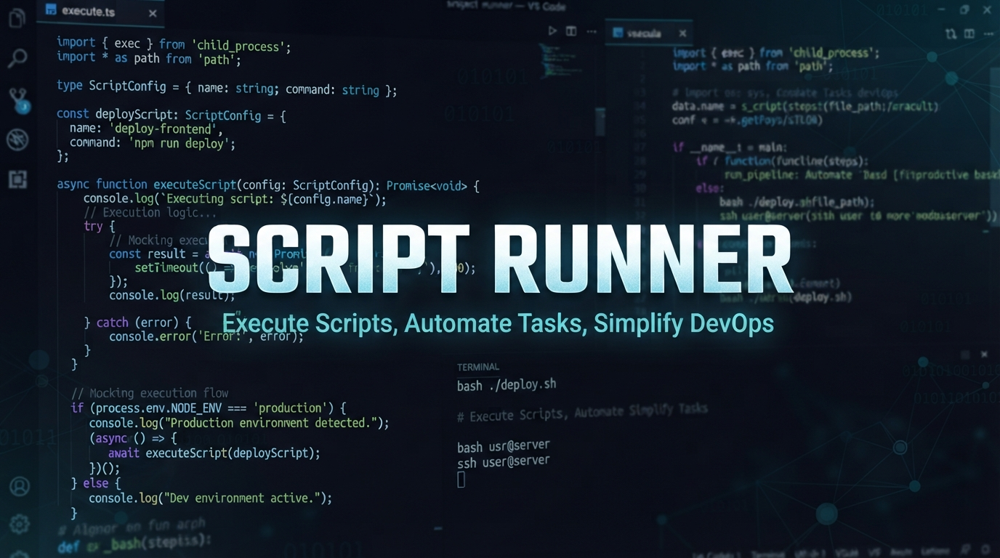

# Script Runner

<p align="center">
  
</p>

Run terminal commands interactively or provide a command through an environment variable for automation.

## Getting started

```bash
git clone https://github.com/Vishnu-301/script-runner.git
cd script-runner
npm install
```

## Run interactively

Start the runner and enter a command at the prompt. Chain commands with `&&`, and type `exit` to quit.

```bash
npm start
```

You can also run it directly:

```bash
npx tsx runner.ts
```

## Run a command non-interactively

Set `COMMAND` to the terminal command you want to run:

```bash
COMMAND="echo Hello from Script Runner" npm start
```

This mode is suitable for automation workflows such as GitHub Actions.
